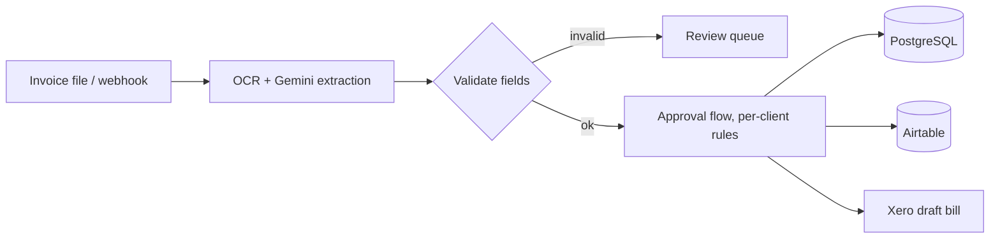

# AP Invoice Automation Engine

A pipeline that takes a vendor invoice, extracts the data with OCR and an LLM, stores it in the client's chosen system, and prepares the bill for approval, so nobody retypes invoices into the ledger.

It grew out of an earlier Xero draft-bill automation and was rebuilt as a multi-destination engine that one build can serve for clients with different accounting setups.

## Architecture

## What it does

1. An invoice arrives (a file dropped in Google Drive, or a webhook).
2. **OCR plus Gemini** extract vendor, invoice number, dates, line items and totals into structured fields.
3. The record is written to the destination the client uses: **PostgreSQL, Airtable or Xero**. The source PDF is attached.
4. A **modular approval flow** decides who must approve before a draft bill is created. Approval rules are configured per client, not hard-coded.

## Design choices

- **Multi-destination.** The same extraction feeds Xero, Postgres or Airtable, so one build serves clients with different systems.
- **Draft, not final.** Bills reach the ledger as drafts that a person approves.
- **Modular approvals.** Thresholds and approvers are configuration, so a client can change them without a rebuild.
- **Keep the evidence.** The original PDF stays attached to the record.

## Stack

| Layer | Tools |
|---|---|
| Orchestration | n8n, Make.com |
| Intake | Google Drive API, webhooks |
| Extraction | Gemini (OCR and structured extraction) |
| Destinations | PostgreSQL, Airtable, Xero API |
